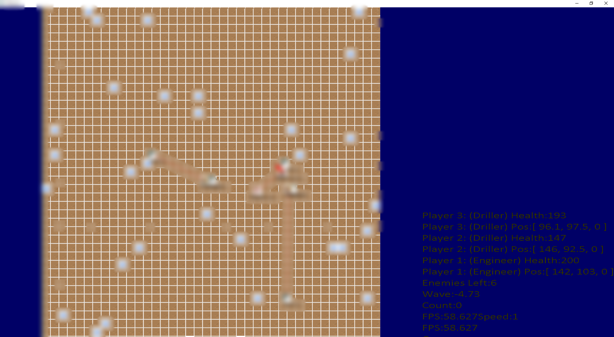
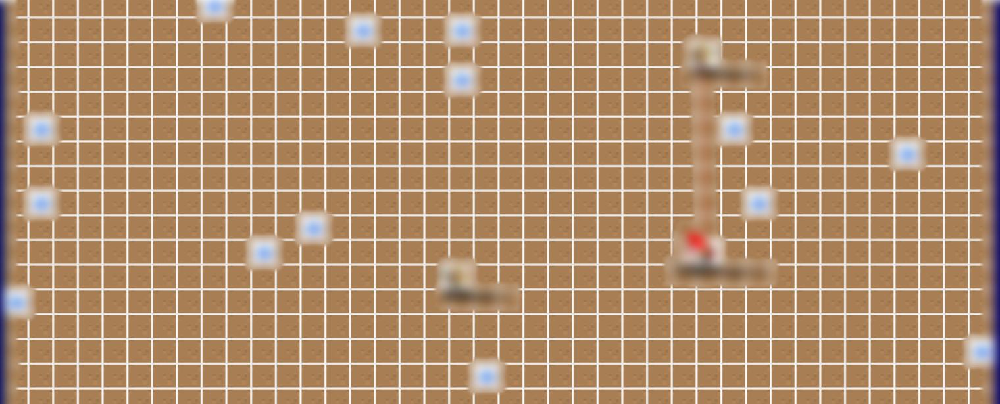
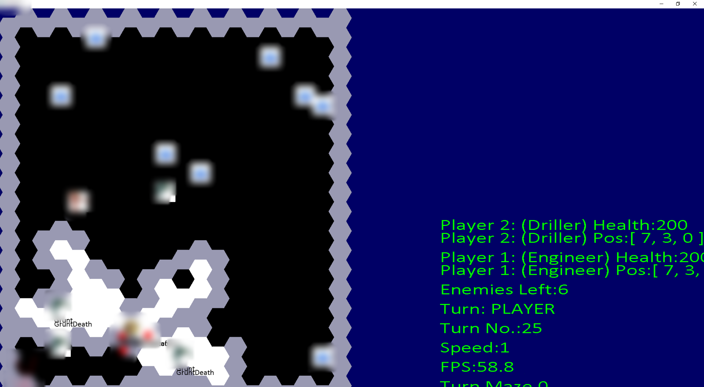
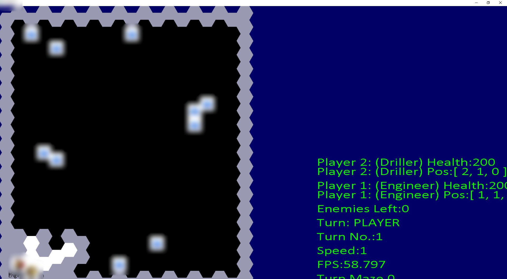

# Game AI: Finite State Machines and Procedural Caves

Two AI simulations written in **C++ and OpenGL** for the AI for Games module at Nanyang Polytechnic (2020–21).

## A1: Mining Expedition (multi-agent FSM simulation)

A real-time simulation where several kinds of agents (player units, fish, sharks, grunts and detonators) each run their own **finite state machine** and coordinate through a **message-passing system** (a post office).

- Generic `StateMachine` / `State` framework, with one set of states per agent type (`StatesFish`, `StatesShark`, `StatesGrunts`, `StatesDetonator`, `StatesPlayer`)
- `PostOffice` / `Message` system so agents can notify each other: nearest ore, enemy or player, crystal mined, explosions, damage, drop pods and incoming waves
- Adjustable simulation speed

| | |
|---|---|
|  |  |

**Controls:** follow the instructions in the console window at start-up · `WASD` move camera · mouse wheel zoom · `+`/`-` speed the simulation up or down

## A2: Cave Tactics (turn-based AI on a procedural map)

A turn-based game on a **procedurally generated cave map**. Units can be controlled by the player or by the AI.

- **Cellular-automata cave generation** ([technique reference](https://gamedevelopment.tutsplus.com/tutorials/generate-random-cave-levels-using-cellular-automata--gamedev-9664))
- **Line of sight and fog of war:** tiles are revealed only when a unit can see them, using ray casting with line-segment intersection
- Path-finding on the grid, plus an FSM for each unit type (Engineer, Driller)
- Switch any time between AI control and player control

| | |
|---|---|
|  |  |

**Controls:** `Space` end turn · `LMB` move the controlled unit · `1` debug rays · `2` AI control · `3` control Engineer · `4` control Driller · `R` reset camera · scroll wheel zoom

## Building

Requirements: Windows and **Visual Studio 2019 or later**.

1. Open `A1-mining-expedition/DM2242_AI.sln` or `A2-cave-tactics/DM2242_AI.sln`.
2. If Visual Studio asks to retarget the toolset or Windows SDK, accept.
3. Set the `AI` project as the start-up project and build (Debug or Release, x86). A post-build step copies `glew/bin/glew32.dll` next to the executable.
4. Run from Visual Studio so the working directory contains `Image/` and `Shader/`.

GLEW and GLFW are included in the repo.

## Credits

The rendering framework (mesh loading, camera, shaders and application loop) was provided by Nanyang Polytechnic as a course base. The AI systems, states, messaging, map generation and line of sight are my own work.

The unit names and theme are inspired by *Deep Rock Galactic*. The original unit icons were game art, so in this repo they have been replaced with plain placeholder sprites (`AI/Image/*.tga`), and they are blurred in the screenshots.
